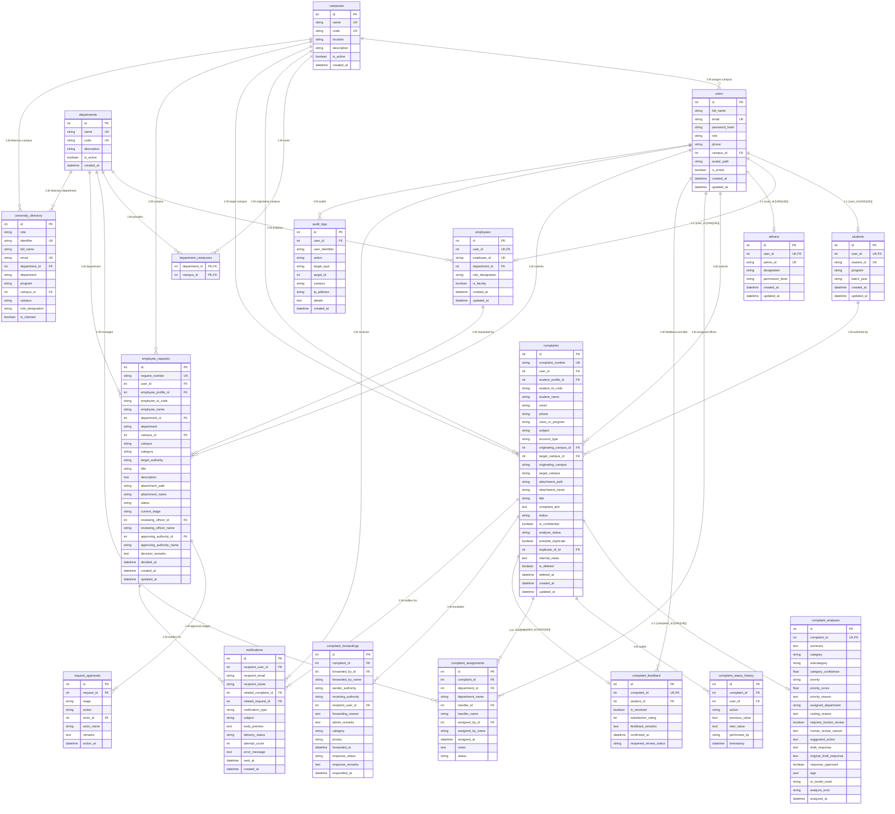

# Entity Relationship Diagram (ERD)
## University Complaint Management Portal - Relational 3NF Architecture

This document provides the formal Entity Relationship Diagram (ERD) for the university complaint management portal. The schema is fully normalized up to the **Third Normal Form (3NF)**, strictly enforcing referential integrity, eliminates repeating groups, eliminates partial dependencies, and isolates role-specific attributes into discrete subtype entities.

---

### ERD Visual Diagram (Mermaid Specification)

---

### Cardinality Summary Table

| Relationship | Cardinality | Primary Entity | Foreign Entity | Foreign Key Column | Constraint & Cascade Rule |
| :--- | :---: | :--- | :--- | :--- | :--- |
| **User to Student** | **1:1** | `users(id)` | `students(user_id)` | `user_id` | `UNIQUE`, `ON DELETE CASCADE` |
| **User to Employee** | **1:1** | `users(id)` | `employees(user_id)` | `user_id` | `UNIQUE`, `ON DELETE CASCADE` |
| **User to Admin** | **1:1** | `users(id)` | `admins(user_id)` | `user_id` | `UNIQUE`, `ON DELETE CASCADE` |
| **Complaint to Analysis** | **1:1** | `complaints(id)` | `complaint_analyses(complaint_id)` | `complaint_id` | `UNIQUE`, `ON DELETE CASCADE` |
| **Complaint to Feedback** | **1:1** | `complaints(id)` | `complaint_feedback(complaint_id)` | `complaint_id` | `UNIQUE`, `ON DELETE CASCADE` |
| **Campus to User** | **1:M** | `campuses(id)` | `users(campus_id)` | `campus_id` | `ON DELETE SET NULL` |
| **Department to Employee** | **1:M** | `departments(id)` | `employees(department_id)` | `department_id` | `ON DELETE SET NULL` |
| **User to Complaint** | **1:M** | `users(id)` | `complaints(user_id)` | `user_id` | `ON DELETE SET NULL` |
| **Complaint to History** | **1:M** | `complaints(id)` | `complaint_status_history(complaint_id)` | `complaint_id` | `ON DELETE CASCADE` |
| **Complaint to Assignment** | **1:M** | `complaints(id)` | `complaint_assignments(complaint_id)` | `complaint_id` | `ON DELETE CASCADE` |
| **Complaint to Forwarding** | **1:M** | `complaints(id)` | `complaint_forwardings(complaint_id)` | `complaint_id` | `ON DELETE CASCADE` |
| **User to Notification** | **1:M** | `users(id)` | `notifications(recipient_user_id)` | `recipient_user_id` | `ON DELETE SET NULL` |
| **User to Employee Request** | **1:M** | `users(id)` | `employee_requests(user_id)` | `user_id` | `ON DELETE CASCADE` |
| **Request to Approval** | **1:M** | `employee_requests(id)` | `request_approvals(request_id)` | `request_id` | `ON DELETE CASCADE` |
| **Department to Campus** | **M:N** | `departments(id)` & `campuses(id)` | `department_campuses` | `(department_id, campus_id)` | Composite PK, `ON DELETE CASCADE` |
