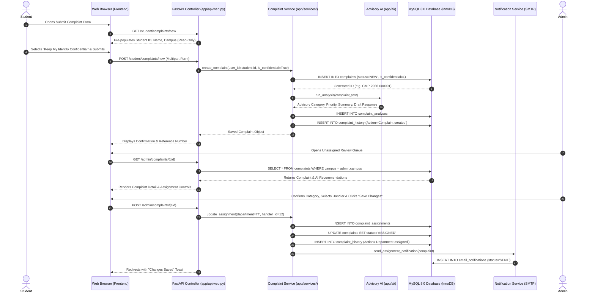

# Complete Project Directory & File Structure Guide

## 1. Project Directory Tree

```text
student_complaint_agent/
│
├── .env                              # Active environment configuration (Database URL, JWT keys, AI provider)
├── .env.example                      # Sanitized configuration template with placeholder settings
├── .gitignore                         # Version control ignore definitions (ignores venv, secrets, logs)
├── complaints.db                     # Local development SQLite file (migrated schema)
├── README.md                          # Repository general overview and quick start guide
├── PRIVACY.md                         # Institutional student privacy and data safeguarding policy
├── requirements.txt                   # Production Python package dependencies (FastAPI, SQLAlchemy, PyMySQL, etc.)
├── run.py                             # Application launcher script with automated port-conflict management
│
├── config/                            # Institutional JSON business configurations (Editable without code changes)
│   ├── campuses.json                  # Official constituent campus registry and location metadata
│   ├── categories.json                # Complaint taxonomy, keyword matching trees, and guidance
│   ├── departments.json               # University academic & administrative departments listing
│   ├── priority_rules.json            # Deterministic urgency scoring rules and threshold weights
│   ├── routing.json                   # Automated routing rules mapping categories to departments
│   └── escalation_authorities.json    # Higher authorities for forwarding (Examinations, Registrar, DSA, VC)
│
├── app/                               # Core Application Package
│   ├── main.py                        # FastAPI application factory, middleware, lifespan hooks, static mount
│   │
│   ├── api/                           # HTTP Web Route Handlers & REST Endpoints
│   │   ├── __init__.py                # API router aggregate
│   │   ├── web.py                     # Primary server-rendered web controller (Dashboards, Complaints, Requests)
│   │   ├── auth.py                    # JWT token creation, cookie authentication, and credentials verification
│   │   └── complaints.py              # RESTful API endpoints for headless or mobile complaint consumption
│   │
│   ├── models/                        # SQLAlchemy Declarative ORM Domain Models (14 Tables)
│   │   ├── __init__.py                # Exports all models, enums, and relationship configurations
│   │   ├── user.py                    # `users` & `university_directory` models (Unified auth, avatars, scoping)
│   │   ├── campus.py                  # `campuses` and `departments` models
│   │   ├── complaint.py               # `complaints` model (Core grievance state, confidentiality, immutability)
│   │   ├── analysis.py                # `complaint_analyses` model (AI categorization, priority score, draft text)
│   │   ├── history.py                 # `complaint_history` model (Chronological action log)
│   │   ├── assignment.py              # `complaint_assignments` model (Handler and department allocation trail)
│   │   ├── forwarding.py              # `complaint_forwardings` model (Escalation history preserving complaint ID)
│   │   ├── feedback.py                # `resolution_feedback` model (Student resolution confirmation and reopening)
│   │   ├── request.py                 # `employee_requests` & `request_approvals` models (Staff applications)
│   │   ├── notification.py            # `email_notifications` model (Transactional message tracking)
│   │   ├── audit.py                   # `audit_logs` model (Security and access audit log)
│   │   └── enums.py                   # Domain Enumerations (UserRole, ComplaintStatus, RequestCategory, Priority)
│   │
│   ├── database/                      # Database Connectivity & Migration Subsystem
│   │   ├── __init__.py
│   │   └── database.py                # SQLAlchemy engine factory (MySQL / SQLite), session scopes, migrations
│   │
│   ├── core/                          # Cross-Cutting Infrastructure
│   │   ├── __init__.py
│   │   ├── config.py                  # Pydantic/dataclass environment loader (`get_settings()`)
│   │   ├── security.py                # Password hashing (bcrypt), JWT generation/decoding, origin checks
│   │   └── exceptions.py              # Domain exceptions (`ComplaintNotFound`, `ComplaintValidationError`)
│   │
│   ├── services/                      # Business Logic & Workflow Services
│   │   ├── __init__.py
│   │   ├── complaint_service.py       # Complaint CRUD, campus isolation, assignment, forwarding, feedback
│   │   ├── user_service.py            # User registration, directory verification, profile updates, avatar files
│   │   ├── request_service.py         # Employee administrative applications and multi-tier approval trail
│   │   ├── notification_service.py    # Non-blocking transactional email delivery and delivery logs
│   │   ├── analysis_service.py        # AI classification runner with fallback to deterministic heuristic rules
│   │   ├── category_service.py        # Taxonomy keyword matching engine
│   │   ├── duplicate_service.py       # Duplicate complaint detection via similarity scoring
│   │   ├── priority_service.py        # Urgency calculator (Critical/High/Medium/Low)
│   │   ├── routing_service.py         # Category-to-department routing rules engine
│   │   └── history_service.py         # Event logging helper
│   │
│   ├── ai/                            # AI Classification Engine
│   │   ├── __init__.py
│   │   ├── client.py                  # LLM connector (Anthropic Claude API client)
│   │   ├── mock_provider.py           # Offline rule-based mock classifier for local development/testing
│   │   ├── prompt.py                  # Few-shot prompts for structured classification
│   │   └── factory.py                 # Provider factory pattern selecting mock vs real provider
│   │
│   ├── schemas/                       # Pydantic Validation Schemas
│   │   ├── __init__.py
│   │   ├── complaint.py               # Request/Response payloads for complaints, assignments, forwarding
│   │   ├── user.py                    # User registration and profile update schemas
│   │   └── analysis.py                # AI output validation models
│   │
│   ├── utils/                         # Reusable Utility Functions
│   │   ├── __init__.py
│   │   ├── text.py                    # Text quality assessment, sanitization, XSS mitigation
│   │   └── time.py                    # UTC timezone formatting and timestamp calculations
│   │
│   ├── static/                        # Web Presentation Assets
│   │   ├── css/style.css              # Custom styling, gold accents, navy headers, responsive cards
│   │   ├── js/app.js                  # Dynamic client-side dropzone, image compression, validation JS
│   │   ├── images/                    # Campus backgrounds and institutional logos
│   │   └── uploads/                   # Secure storage for uploaded attachments and user avatars
│   │       ├── avatars/               # User profile photos
│   │       ├── complaints/            # Supporting grievance photos
│   │       └── requests/              # Employee application PDF/image documents
│   │
│   └── templates/                     # Jinja2 HTML Templates
│       ├── base.html                  # Global layout with role-based navigation bar and header
│       ├── _macros.html               # Reusable status badges, priority badges, flash messages
│       ├── login.html                 # Login page with campus validation dropdown
│       ├── profile.html               # User profile view and edit page with photo upload
│       ├── student_dashboard.html     # Student portal landing page with stats and recent complaints
│       ├── student_complaints.html    # Student full complaints history table
│       ├── student_complaint_form.html# Auto-populated complaint form with confidentiality option
│       ├── student_complaint_detail.html # Complaint detail, timeline, and resolution verification form
│       ├── employee_dashboard.html    # Employee portal dashboard
│       ├── employee_requests.html     # Employee administrative applications history list
│       ├── employee_request_form.html # Staff application submission form (Leave/Workload/Timetable)
│       ├── employee_request_detail.html # Request detail with chronological approval trail
│       ├── dashboard.html             # Central Administrator dashboard with unassigned review queue
│       ├── complaint_detail.html      # Administrator complaint triage, assignment, forwarding modal
│       ├── admin_users.html           # Campus-isolated user management with category tabs
│       ├── admin_departments.html     # Department listing
│       ├── admin_reports.html         # Grievance volume and resolution analytics
│       └── admin_settings.html        # System settings
│
├── tests/                             # Comprehensive Automated Test Suite (134 Tests)
│   ├── conftest.py                    # Pytest test fixtures, client overrides, database setup
│   ├── test_module_workflows.py       # E2E acceptance tests for all 13 Master Prompt scenarios
│   ├── test_complaints.py             # Complaint lifecycle, attachment, and XSS validation tests
│   ├── test_rbac.py                   # Role-based access control and campus isolation tests
│   ├── test_priority.py               # Urgency priority calculation tests
│   ├── test_duplicates.py             # Duplicate complaint detection tests
│   ├── test_routing.py                # Department routing tests
│   ├── test_ai_parser.py              # AI response parsing and validation tests
│   ├── test_campus_features.py        # Multi-campus data isolation tests
│   ├── test_employee_admin_enhancements.py # Employee & admin UI enhancements tests
│   ├── test_profile_avatar.py         # Avatar upload and sizing tests
│   └── test_upload_limits.py          # File upload 500KB boundary tests
│
└── docs/database/                     # Database Presentation & Design Documentation
    ├── README.md                      # Index and navigation for database documentation
    ├── schema_design.md               # Detailed schema, normalization, table design
    ├── relational_schema.md           # Formal relational algebra notation & cardinalities
    ├── table_catalog.md               # 14-table catalog and operational matrix
    ├── er_diagram.mmd                 # Mermaid ER diagram source
    ├── er_diagram.svg                 # High-resolution vector graphic ER diagram
    ├── database.sql                   # MySQL 8.0 DDL script
    ├── sample_data.sql                # Complete fictional demonstration dataset
    ├── file_structure.md              # Project file guide and execution flow
    └── presentation_guide.md          # Viva presentation guide & technical Q&A
```

---

## 2. End-to-End Execution Flow

To explain how data travels through the system during presentation, trace this complete request lifecycle:


